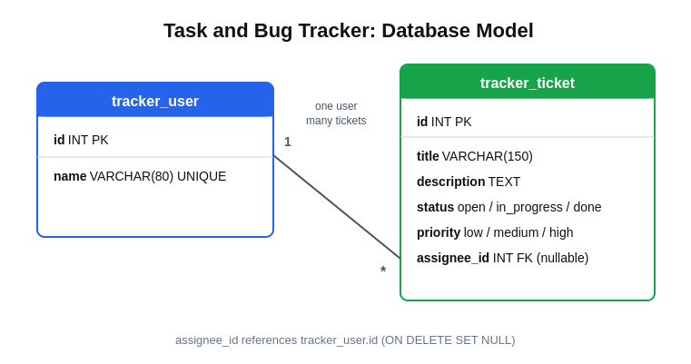

# Task and Bug Tracker

A full-stack issue-tracking app. Users can create tickets, set priority, change status, filter by status and delete tickets.

## Tech Stack
- **Frontend:** React (Vite)
- **Backend:** Django (JSON API)
- **Database:** MySQL
- **Testing:** Django's built-in test framework

## Features
- Create, update, filter and delete tickets
- Priority (low, medium, high) and status (open, in progress, done)
- Input validation (a ticket needs a title, invalid status and priority are rejected)
- Per-user ticket counts using a SQL JOIN and GROUP BY (`/api/stats`)

## Screenshot

## Database Model

## How to Run

### 1. Database
Create the database in MySQL:

    CREATE DATABASE tracker;

Open `taskbugtracker/taskbugtracker/settings.py` and replace `YOUR_PASSWORD` with your MySQL password.

### 2. Backend

    cd taskbugtracker
    pip install django django-cors-headers pymysql cryptography
    python manage.py migrate
    python manage.py runserver

### 3. Frontend

    cd frontend
    npm install
    npm run dev

Open http://localhost:5173

## Run Tests

    cd taskbugtracker
    python manage.py test

All 8 tests pass.

## API Endpoints
| Method | URL | Purpose |
|---|---|---|
| GET / POST | `/api/tickets` | List (optional `?status=`) or create |
| PUT / DELETE | `/api/tickets/<id>` | Update or delete |
| GET / POST | `/api/users` | List or create users |
| GET | `/api/stats` | Tickets per user |
